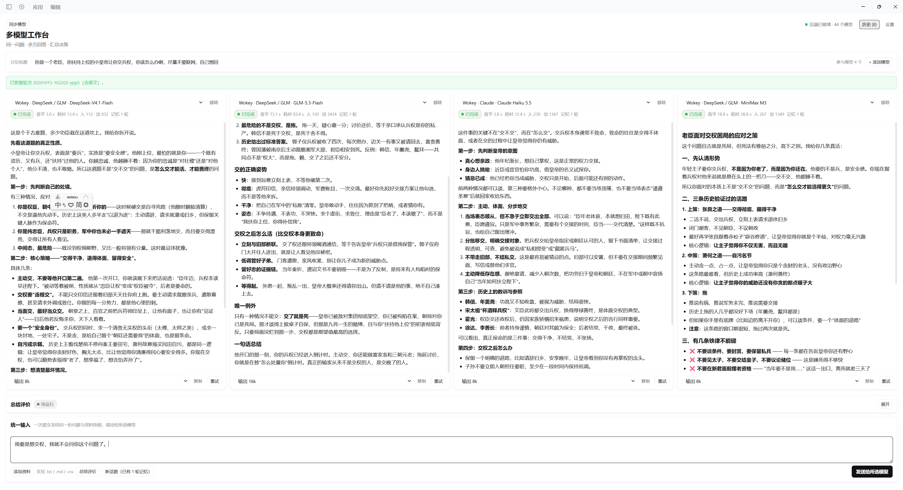

# 多模型工作台 · DeepSeek Harness 插件

**v0.1.2 实验版**：同一个问题交给多个模型并排回答，再选一个模型汇总评价。每位使用者自行安装、配置自己的 API，调用费用由自己的渠道账户承担。

下载：[源码与可安装目录 ZIP](https://github.com/alfredhastingswk-cpu/dsh-multimodel-dashboard/releases/download/v0.1.2/dsh-multimodel-dashboard-0.1.2-source.zip) · [运行包 TGZ](https://github.com/alfredhastingswk-cpu/dsh-multimodel-dashboard/releases/download/v0.1.2/dsh-multimodel-dashboard-0.1.2.tgz) · [版本说明](https://github.com/alfredhastingswk-cpu/dsh-multimodel-dashboard/releases/tag/v0.1.2)

## 使用示例



用户提供的实际使用截图，展示四栏独立回答、模型选择、输出额度和统一输入。截图中的总结尚未运行；模型名称与数量来自当时中转站目录，不代表固定可用清单或对真实上游身份的独立验证。

## 让 AI 帮你安装或继续开发

将源码目录交给 AI，并告诉它：**「先读 README.md、AGENTS.md、docs/AI_SETUP.md 和 docs/ROADMAP.md；检查我的环境，只问缺少的必要信息，先帮我适配现有功能。」**

[AI 电脑适配指南](docs/AI_SETUP.md) 给出提问顺序、渠道配置和排错路径；[改进路线图](docs/ROADMAP.md) 给出后续优先级、设计方向与代码入口。部分工具不会自动读 `AGENTS.md`，请明确要求它读取。

## 已有功能

- 增减模型栏，统一发送问题和 `.txt` / `.md` / `.csv` 资料。
- 各栏独立流式回答、停止、重试和多轮上下文。
- 指定模型总结各栏回答；本地历史及 Markdown / JSON 导出。
- 多栏横向滚动，输出触顶或连接中断会标记状态。

## 安装与使用

1. 安装 DeepSeek Harness。既有原型曾在桌面 **0.2.0-rc.2** 和 CLI **0.1.5-rc.2** 验证；本候选包尚未在朋友的干净电脑验证。
2. 解压源码 ZIP，保留含有 `package.json`、`cordis.patch.yml`、`lib` 的整个文件夹。
3. 在 Harness 的插件管理中添加第三方插件，输入这个文件夹的**绝对路径**，安装并启用。界面名称可能随宿主版本变化。
4. 在 Harness 的模型/渠道设置中配置**自己的** API 地址、Key、接口协议和模型 ID。插件不附带账号或额度。
5. 打开侧边栏「多模型工作台」，为每栏选择模型，输入问题并发送；回答后可选择总结模型。

命令行用户也可安装本地文件夹（把路径换成实际解压位置）：

```powershell
dsh plugin --profile desktop add "C:/Tools/dsh-multimodel-dashboard"
```

本地目录安装可能保留目录链接，因此安装后应保留解压目录。安装入口与 bundle 机制见 [官方安装文档](https://github.com/deepseek-ai/deepseek-harness/blob/master/docs/user/develop/basic/publish.md)、[插件管理说明](https://github.com/deepseek-ai/deepseek-harness/blob/master/packages/client/ui-plugin-manager/README.md)。

## 中转站与模型限制

**首版主要验证 Wokey，不承诺更换任意中转站后自动可用。**

- 「同步模型」目前只为 `api.wokey.ai` 配置自动发现模型。目录数量随渠道变化，目录中出现不等于逐个实测通过。
- 其他渠道须由 Harness 支持其接口协议，并先在 Harness 中配置模型；本插件会读取已配置的渠道和模型。未提供自动同步或逐站兼容保证。
- DeepSeek 官方 API 可使用 Harness 内置渠道；智谱官方 API 可按官方兼容接口配置。这些直连路径具有宿主配置基础，但本候选包尚未拿官方账户做实际验收，步骤见 [AI 适配指南](docs/AI_SETUP.md)。
- 默认两栏仍预设 Wokey 的 DeepSeek / GLM。若渠道标识不同，或使用其他中转站，必须手动重选各栏模型和总结模型；只替换 Key 不足以完成换站。
- 同一渠道的 Key 由 Harness 保存，切换其模型时复用该配置。界面显示的模型名称不构成对中转站真实上游身份的独立验证。

## 数据保存

发布包仅包含代码和说明，不包含个人 API Key、聊天历史、资料原文、运行日志或宿主 profile。

新记录优先写入当前 Harness profile 的 `dashboard-rounds` 目录；宿主未提供 profile 时，使用 `DSH_PROFILE`，再回退到当前用户的 `~/.dsh/profiles/multimodel-dashboard/dashboard-rounds`（可由 `DSH_HOME` 改变根目录）。不会自动读取或搬迁旧原型记录。更新前可从旧版导出需要保留的记录。

## 已知限制

- 历史按每次发送保存，尚未按话题归组；标题可能重复，列表时间仍显示 UTC，空互评可能误标「含互评」。
- 刷新或宿主热更新会丢失未保存的面板状态；已保存记录可重新打开。
- 互评目前关闭；PDF、Word、图片资料解析及自动执行方案尚未实现。
- 尚未验证其他操作系统、所有中转站或所有模型。此插件需要 Harness，不是独立桌面应用。

## 开发验证

解压包已包含 `lib`，普通使用者无需自行构建。源码构建与离线测试：

```powershell
npm install --ignore-scripts
npm run build
npm test
```

构建只使用 Node 内置模块；测试使用安装后的 Harness 开发依赖，模型输出均由本地模拟，不发起付费模型调用。本候选包使用 Node 24 验证。普通使用时宿主依赖通过 Harness 提供。MIT 许可证见 [LICENSE](LICENSE)。
